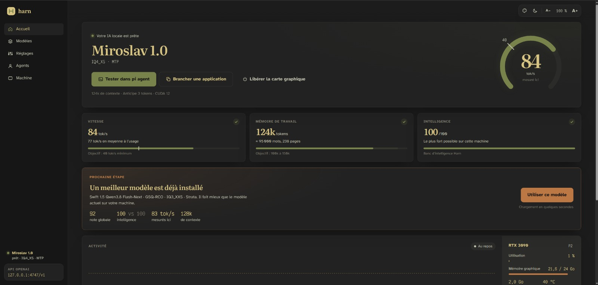
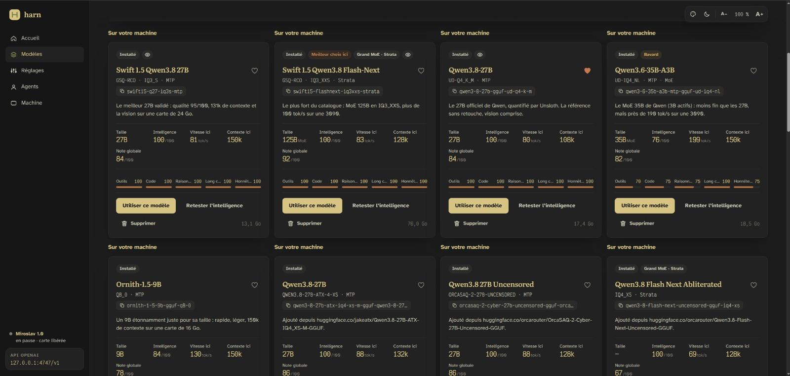

# Harn

Une IA locale qui tourne bien, sans rien régler. Double-cliquer sur `Harn-install.cmd` (ou
lancer `./Harn-install.sh` sous Linux) : l'application analyse la machine, installe le bon
moteur et le meilleur modèle validé, le règle et le mesure, puis installe **pi agent** déjà
branché dessus. Ensuite elle sert une API compatible OpenAI, fait tourner des agents (Telegram
compris) et génère des images, le tout sur votre carte graphique.

*A local AI that sets itself up: hardware detection, engine and model choice, tuning and
benchmarks, an OpenAI-compatible API and agents. Interface and documentation in French.*





## Prérequis

- Windows 10/11 ou Linux x86_64.
- Une carte graphique NVIDIA de préférence (12 Go et plus pour les modèles 27B). Radeon via
  Vulkan ; sans carte graphique, un petit modèle tourne sur le processeur.
- Node.js 22.19 ou plus récent : installé par `Harn-install` s'il manque.
- De la place disque : de 6 Go (Bonsai) à 76 Go (Flash-Next) par modèle.

Sous Linux, quelques paquets optionnels débloquent des fonctions (Strata, tmux, presse-papiers,
bubblewrap) : voir [« Optionnel sous Linux »](#optionnel-sous-linux).

## Installer, lancer, arrêter

- `Harn-install.cmd` (double-clic) : premier lancement. Installe Node.js s'il manque, puis tout le
  reste depuis l'interface.
- `Harn-start.cmd` (double-clic) : lance Harn, ou le relance s'il tourne déjà, et ouvre la fenêtre.
- `Harn-stop.cmd` (double-clic) : ferme Harn. Si quelque chose est en cours, il l'affiche et
  demande s'il faut arrêter quand même.
- Sous Linux : `./Harn-install.sh`, `./Harn-start.sh` et `./Harn-stop.sh` font la même chose.
  L'installeur pose Node.js dans `~/.local/node` (sans sudo) s'il manque, et ajoute au menu des
  applications les lanceurs « Harn », « Harn - arrêter » et « Harn - installer » (le gestionnaire
  de fichiers de GNOME ouvre les `.sh` dans l'éditeur au lieu de les lancer).
  `./Harn-install.sh --lanceurs` ne fait que (re)créer ces lanceurs.
- `npm run restart` / `npm run stop` : la même chose en ligne de commande.

Avant d'arrêter, ces commandes demandent à Harn ce qui est en cours : première installation,
ajout ou installation d'un modèle, réglage, banc de vitesse, test d'intelligence, téléchargement,
analyse de la machine, chargement d'un modèle, réponse en cours de génération. Si quelque chose
tourne, elles l'affichent et n'arrêtent rien. Ajoutez `--force` pour couper quand même
(`npm run restart -- --force`). Les sessions pi ouvertes sont signalées : elles restent ouvertes,
mais n'ont plus de modèle le temps du redémarrage.

L'arrêt est propre : Harn coupe le moteur et enregistre son état avant de quitter. Après un
`restart`, Harn tourne en arrière-plan, sans fenêtre de console, et écrit dans
`data/logs/harn.log`. La fenêtre de l'interface déjà ouverte se reconnecte seule ; s'il n'y en
avait pas, une nouvelle s'ouvre.

Tout vit dans le dossier du dépôt (`runtime/`, `models/`, `data/`, `workspace/`, hors git) :
déplacer le dossier déplace l'installation.

### Mises à jour

Au démarrage puis toutes les 6 h, Harn compare sa version au dernier commit de `main` sur GitHub
et propose la nouvelle par un bouton, qui l'applique et relance Harn. Seul le code change :
`data/`, `models/`, `runtime/` et `workspace/` ne sont jamais touchés.

- Installé par `git clone` : `git pull --ff-only`, refusé s'il y a des modifications locales ou des
  commits non publiés.
- Installé depuis une archive dézippée : Harn télécharge l'archive du commit et recopie le code.

## Utilisation

- Interface : <http://127.0.0.1:4747>
- API OpenAI : `http://127.0.0.1:4747/v1`. Si le champ `model` désigne un autre modèle installé,
  celui-ci est chargé.
- Après dix minutes sans requête, le modèle est déchargé et la carte graphique rendue au bureau.
  La requête suivante le recharge toute seule (elle attend le temps du chargement).
- Pour brancher une autre application (Copilot, un éditeur, un autre poste du réseau) : voir
  [« Sécurité de l'inférence »](#sécurité-de-linférence).

## Ce qui se passe au premier démarrage

| Étape | Détail |
|---|---|
| Analyse | Carte graphique (VRAM, version CUDA du pilote, génération), RAM, cœurs, disque, Git Bash |
| Moteur | Dernier build llama.cpp officiel (CUDA 13, CUDA 12.4, Vulkan ou CPU selon le pilote) ; fork Prism pour Bonsai |
| Modèle | Le meilleur modèle UkisAI qui tient entièrement sur la carte, téléchargement reprenable |
| pi agent | `@earendil-works/pi-coding-agent` dans `runtime/pi`, configuré dans `data/pi-agent`, avec la recherche web ketch |
| Chargement | Contexte réduit tant que la VRAM libre reste sous 1,5 Gio |
| Réglage | Banc code + texte, un levier à la fois ; la variante la plus rapide reste chargée |
| Intelligence | Banc d'intelligence de Harn, puis note globale du modèle sur cette machine |

Les trois longues attentes (moteur, poids, pi) se font en parallèle.

## Choix du modèle

| Machine | Premier modèle | Proposé ensuite |
|---|---|---|
| Moins de 8 Go de VRAM, ou sans carte graphique | Swift Bonsai 2 1-bit (Prism) | — |
| 9 à 11 Go | Swift Bonsai 2 2-bit | — |
| 12 Go | Swift 1.5 Qwen3.8 27B GSQ-RCO IQ2_XS-mtp | Flash-Next Strata IQ2_XS si 48 Go de RAM |
| 16 Go | 27B GSQ-RCO IQ3_XXS-mtp | Flash-Next Strata IQ3_XXS si 60 Go de RAM |
| 20 Go et plus | 27B GSQ-RCO IQ3_S-mtp, 131k | Flash-Next Strata IQ3_XXS si 60 Go de RAM |

Flash-Next (68 à 76 Go) n'est jamais téléchargé d'office : il est proposé une fois que la
machine a déjà une IA qui marche, et il s'installe pendant que le premier modèle continue de servir.

Aussi au catalogue, à installer depuis la vue Modèles :

| Modèle | Pour quoi |
|---|---|
| Qwen3.8 Flash-Next Coder IQ1_M (Strata) | le grand MoE réduit au code ; tient avec 32 Go de RAM |
| Qwen3.8-27B UD-Q4_K_M (Unsloth) | le 27B officiel de Qwen, sans retouche, vision comprise |
| Qwen3.6-35B-A3B UD-IQ4_NL (MoE) | moins fin que les 27B, mais près de 190 tok/s sur une 3090 |
| Ornith-1.5-9B Q8_0 | un 9B rapide et léger, 150k de contexte sur une carte de 16 Go |

### Ajouter un modèle depuis Hugging Face

Vue Modèles : coller l'adresse d'un dépôt GGUF. pi l'analyse pour la carte, propose la meilleure
quantification, puis Harn la télécharge, la règle, la mesure et teste son intelligence.

Harn surveille aussi Hugging Face : les GGUF sortis ou mis à jour ces 30 derniers jours, chez les
auteurs que le catalogue suit et parmi les tendances, sont proposés s'ils tournent sur la machine.

Un fichier déjà sur la machine (même nom, même taille : dossier `models/`, LM Studio, cache
Hugging Face, Documents, Téléchargements) est repris tel quel, sans téléchargement. C'est aussi
la façon d'installer un dépôt à accès restreint (`gated`), que Harn ne peut pas télécharger faute
de jeton Hugging Face : copier le fichier dans `models/`, puis donner l'adresse du dépôt. Harn
lit alors l'architecture dans le fichier local.

Un Flash-Next (architecture `qwen4exp`) ajouté ainsi va sur Strata et non sur llama.cpp, dès que
Strata est déjà sur la machine (un Flash-Next du catalogue l'apporte, avec sa tête MTP). Strata
prépare un « pack » à côté des fichiers, sans les réécrire. Mesuré sur une RTX 3090 avec
l'Uncensored d'OrcaRouter en IQ4_XS (97 Go) : 69 tok/s à 131k sous Strata, contre 34 sous
llama.cpp, qui laisse les experts au processeur. Pas de vision par cette voie pour l'instant.
Sans Strata, le modèle s'installe sous llama.cpp, avec sa tête MTP à part si le dépôt en livre une.

## Intelligence et note globale

Chaque modèle installé passe le **banc d'intelligence** de Harn : une note sur 100, commune à
tous les modèles, corrigée automatiquement (réponses uniques, appels d'outils contrôlés, numéros
de ligne des erreurs), sans modèle juge.

| Domaine | Poids |
|---|---|
| Outils (enchaînements d'appels) | 35 % |
| Code | 25 % |
| Raisonnement | 20 % |
| Long contexte | 10 % |
| Honnêteté | 10 % |

Le test est adaptatif : chaque domaine commence au palier difficile ; réussi, il monte au palier
limite, raté, il redescend au plancher. 100 n'est atteint qu'en réussissant les paliers limite.
La longueur de réflexion n'entre pas dans la note : un modèle qui réfléchit longuement porte le
marqueur « Bavard » (il est plus lent à l'usage, pas moins juste). « Retester l'intelligence »
relance le banc.

La **note globale** dit ce que vaut un modèle sur cette machine : intelligence 40 %, taille 25 %
(un MoE compte pour 75 % de ses paramètres), vitesse mesurée 20 %, contexte 15 %. C'est elle qui
désigne le « Meilleur choix ici » (parmi les modèles qui tiennent 100k de contexte à 40 tok/s)
et qui fait proposer, sur l'accueil, un modèle installé mieux
noté que le modèle actuel.

## Les réglages : des a priori par carte, puis la mesure

Ce qui paie sur une 3090 ne paie pas forcément ailleurs. `src/levers.mjs` classe la carte
(architecture, bande passante mémoire) et en tire des points de départ. Le banc les remet
ensuite en cause, une variable à la fois, sur la machine réelle.

| Levier | A priori | Ce que le banc compare |
|---|---|---|
| Spéculation MTP | n-max 2 et p-min 0,7 sous 500 Go/s ; n-max 4 sans seuil au-delà | les voisins (n ± 1, avec ou sans seuil) |
| DFlash2 | seulement sur NVIDIA Ampere ou plus récente, avec plus de 4,5 Gio libres | brouillon z-lab Q4_K_M (1,1 Go) contre le meilleur MTP |
| Type de KV | q8_0 | f16 avec plus de 4 Gio libres, jugé sur une charge de ~20k tokens |
| Flash Attention | activée | désactivée sur Turing et plus ancien |
| Backend | CUDA 13 si le pilote le permet (seul build avec les cœurs FP4 de Blackwell) | Radeon RDNA 3/4 : Vulkan contre HIP ; RTX 30 : llamAmpere contre l'officiel |
| Strata | réglages de l'installeur | `--draft-vocab fr`, `--kv k8v4`, `--pcie-frac 0.35` |

Règles qui valent partout :

- **Marge VRAM ≥ 1,5 Gio** (`--fit on --fit-target 1024`, contrôle après chargement). Sans
  elle, le préfill retombe sur la mémoire hôte, sans erreur. Une variante qui l'entame est
  écartée, même si elle va plus vite.
- **Vision sur CPU** (`--no-mmproj-offload`) : environ 0,9 Gio rendu au contexte.
- **Raisonnement `medium` par défaut**, car `xhigh` vide les réponses sur les runs longs.
- **Débit lu dans les compteurs du moteur** (`/slots`, `timings`).
- **Fenêtre annoncée à pi = la vraie fenêtre**, plafond de sortie indépendant.
- **Un seul moteur sur la carte**, avec reprise des orphelins par PID.

Réglages Windows signalés dans l'interface : mode d'alimentation (corrigeable en un clic),
batterie, VRAM déjà occupée, « CUDA – Stratégie de retour à la mémoire système » et
« Mode de gestion de l'alimentation » NVIDIA (à régler dans le panneau NVIDIA).

Chaque machine a son carnet, `docs/machines/<carte>-<ram>.md`, créé localement (hors git) : Harn y
réécrit les mesures après chaque banc, l'IA locale y rédige son analyse (objectif, leviers, pistes
à tester), et pi agent est invité, par son `AGENTS.md`, à y ajouter des notes datées. La référence
générale des leviers, avec ses sources : [docs/leviers-inference.md](docs/leviers-inference.md).

Pas encore intégré : **NVFP4 sur Blackwell**. UkisAI publie `Swift-1.5-Qwen3.8-27b-NVFP4`
(safetensors ModelOpt), convertible en GGUF avec `convert_hf_to_gguf.py --fp8-as-q8`. Le
noyau sm_120 natif (b8967+) accélère la lecture du prompt de 43 à 68 %, la génération ne
change pas. Il reste à valider la qualité, la présence de la tête MTP et la taille réelle.

## Agents

Vue Agents : un agent par personne. Chacun a sa fiche, son dossier pi et son dossier de travail
dans `data/agents/<id>/` (hors dépôt), sans rien de commun avec les autres ni avec le pi de test.

```text
data/agents/<id>/agent.json                   la fiche : nom, modèle, cases, bot Telegram
data/agents/<id>/MEMORY.md                    sa mémoire
data/agents/<id>/workspace/                   son dossier de travail
data/agents/<id>/workspace/files/             les fichiers qu'on lui envoie
data/agents/<id>/pi-agent/APPEND_SYSTEM.md    ses consignes
data/agents/<id>/pi-agent/sessions/           ses conversations
```

- **Créer** : le champ « Prénom de la personne » en haut de la vue, puis « Créer un agent ».
- **Cases** : shell, outils de Harn, recherche web, mémoire, images, lancer avec Harn. Un nouvel agent n'a
  ni shell ni outils de Harn : on coche ce dont il a besoin.
- **Modèle d'images** : celui que l'agent prend quand il ne demande pas un modèle précis (sinon le
  premier installé). Pour une retouche, si ce modèle ne sait pas retoucher, Harn en prend un qui
  sait. L'agent peut toujours en demander un autre, à la demande de la personne.
- **Mémoire** : l'agent note lui-même ce qu'il juge durable et le relit au début de chaque
  conversation (6 000 caractères au plus, modifiables dans la fiche).
- **Telegram** : un bot par agent. Le jeton vient de @BotFather, l'identifiant de la personne de
  @userinfobot ; seule cette personne est écoutée. Ses messages vont à l'agent, la réponse finale
  lui revient, `/new` ouvre une nouvelle conversation. Photos et fichiers (20 Mo au plus, limite
  de Telegram) sont rangés dans `workspace/files/` ; une image est aussi montrée au modèle quand
  il sait voir. Cocher « Lancer avec Harn » pour que le bot réponde sans ouvrir de fenêtre.
- **La carte graphique** : avant d'injecter un message reçu, l'agent la demande. Libre, il la
  prend. Occupée par quelqu'un d'autre, la demande s'affiche dans la fenêtre de Harn.

Sous Linux avec tmux :

- Chaque agent tourne dans sa session, sur un serveur tmux propre à Harn : vos sessions tmux ne
  sont pas touchées. Pour s'y rattacher à la main : `tmux -L harn ls`, puis
  `tmux -L harn attach -t harn-<id>`.
- La fiche affiche « en marche » quand le pi de l'agent tourne.
- « Ouvrir » rouvre le terminal de l'agent. Si son modèle, ses outils, ses consignes ou son bot ont
  changé depuis son démarrage, son pi est relancé et reprend sa conversation.
- « Tout voir » (dès que deux agents sont en marche) : tous dans une seule fenêtre, un panneau
  chacun. La souris choisit le panneau ; un agent qui démarre la rejoint ; la fermer n'arrête
  personne.
- Supprimer un agent arrête son pi et efface tout son dossier.

## Images

Un agent dont la case « Images » est cochée a un outil `generate_image` : il génère une image à
partir d'une description, ou retouche une image de son dossier de travail. Il reçoit aussi le
skill `ecrire-une-image` : traduire en anglais une demande courte (« un chat dans l'espace ») et
la compléter (sujet, cadrage, lumière, style, format), retoucher sans tout redécrire, se servir
d'un LoRA de visage, refaire avec la même graine. Aucune interface à
part : Harn fait tourner [stable-diffusion.cpp](https://github.com/leejet/stable-diffusion.cpp)
en coulisses, comme llama.cpp pour le texte, et l'installe avec le premier modèle d'images.

Vue Modèles, section Images :

| Modèle | À télécharger | Sur une RTX 3090 (1024 × 1024) |
|---|---|---|
| FLUX.2 klein 4B (Apache-2.0) | 8,9 Go | ~15 s |
| Qwen-Image 2.1 Uncensored (licence Qwen Research, non commercial) | 18,2 Go | ~85 s |

- La carte graphique ne tient pas les deux : le temps d'une image, le modèle de texte est
  déchargé, puis rechargé. Une requête qui arrive entre-temps attend, elle n'est pas refusée.
- L'image est rangée dans `images/` du dossier de travail de l'agent, montrée au modèle quand il
  sait voir, et envoyée dans le chat Telegram de la personne si l'agent a un bot.
- Les images à retoucher ne sont lues que dans le dossier de travail de l'agent (les fichiers
  reçus par Telegram sont dans `files/`).
- **LoRA** : les `.safetensors`, `.gguf` ou `.ckpt` posés dans `lora/` du dossier de travail de
  l'agent s'appliquent depuis la description, avec la syntaxe `<lora:nom:echelle>`. Ils sont à
  cet agent seul (un visage, souvent). Harn lit dans chaque fichier la famille pour laquelle il a
  été entraîné (métadonnées d'ai-toolkit ou de kohya) : sans `model` précisé, il prend un modèle
  installé de cette famille ; un modèle incompatible, un LoRA absent ou deux LoRA de familles
  différentes sont refusés avec la raison. L'agent reçoit la liste de ses LoRA à chaque tour, et
  la fiche de l'agent les montre (supprimer un LoRA s'y fait). Sur la fiche, une note par LoRA
  dit ce qu'il représente et comment s'en servir (« le visage de Xavier ; commencer par… ») :
  l'agent la reçoit avec la liste, et le mot déclencheur quand le fichier en porte un
  (`modelspec.trigger_phrase`). Pour en trouver, la fiche et l'agent ont, pour chaque famille
  installée, un lien vers ses LoRA sur Hugging Face (adaptateurs du modèle de base) et sur
  Civitai. Avec la case Shell, l'agent télécharge lui-même le LoRA demandé dans son dossier
  `lora/` puis l'essaie sur une petite image ; sans elle, il donne le lien et le dossier. Quand le moteur n'en applique
  qu'une partie (« Only 320 / 384 LoRA tensors », typique d'un LoRA d'ai-toolkit non converti),
  l'agent en est averti dans la réponse de `generate_image`.
- Moteur : build CUDA 12 sous Windows avec une NVIDIA, Vulkan ailleurs (aucun build CUDA n'est
  publié pour Linux), CPU sans carte graphique.

### Ajouter un modèle d'images depuis Hugging Face

Sous la liste, collez l'adresse d'un dépôt GGUF puis « Analyser ». Harn reconnaît la famille du
modèle (par le nom du fichier, du dépôt ou son tag `base_model`), prend la plus grosse version qui
tient sur la carte (Q8 au plus) et ajoute ce que le dépôt ne livre pas : le décodeur et le lecteur
de consigne de la famille, en Q8 sur une carte de 12 Go et plus, en Q4 en dessous. Ces fichiers
sont partagés entre les modèles d'une même famille (`models/image/shared/`) et ne sont effacés
qu'avec le dernier modèle qui s'en sert.

Familles reconnues : FLUX.1 (dev, schnell, Krea, Kontext), FLUX.2 klein 4B/9B et base, FLUX.2 dev,
FLUX.3 klein, Chroma, Qwen-Image (2512, Edit, Edit 2511, 2.1, 2.1 Turbo), Z-Image et Z-Image Turbo,
Krea 2 et Krea 2 Turbo, ERNIE-Image et ERNIE-Image Turbo. Les réglages (étapes, CFG) sont ceux
de la documentation de stable-diffusion.cpp. Un dépôt d'une autre famille, sans GGUF ou à accès
restreint est refusé avec la raison.

**Proposés pour votre carte** : une fois par jour, Harn parcourt les modèles d'images GGUF les plus
aimés et les plus en vogue sur Hugging Face, garde ceux d'une famille reconnue qui tiennent sur la
machine (carte et mémoire vive), deux par famille au plus, et masque les familles déjà dans la
liste. « Écarter » retire une proposition pour de bon.

Un modèle qui ne sait pas retoucher (FLUX.1 dev, Z-Image…) refuse les images de référence et
indique ceux qui savent ; pi le sait d'avance.

**Depuis un agent** (case « Outils de Harn ») : `list_image_models` (la liste et les propositions
du jour), `inspect_image_repo` et `install_image_model`, guidés par le skill
`installer-un-modele-images`. L'installation s'affiche d'abord dans la fenêtre de Harn (modèle,
taille, licence) et ne démarre qu'au clic sur Accepter. Supprimer un modèle reste réservé à la
fenêtre.

## Sécurité de l'inférence

- **Clés API** (Machine → Brancher une application, ou `npm run keys -- create "Portable — Copilot"`,
  `list`, `revoke <id>`). Tant qu'aucune clé n'existe, `/v1` répond sans clé, à cette machine
  seulement. La première clé ferme la porte, en local aussi. Seule l'empreinte SHA-256 est gardée
  (`data/api-keys.json`). pi agent, le banc et l'analyse utilisent la clé interne de Harn
  (`data/harn.key`), qui ne compte pas comme une clé créée et n'ouvre jamais le réseau.
- **Clé dans l'URL** pour les clients qui ne laissent pas saisir de clé (Copilot) :
  `http://127.0.0.1:4747/k/<clé>/v1`. L'adresse peut finir dans les journaux du client.
- **Réseau local** : un port à part (`4748`, `HARN_LAN_PORT`) qui ne sert que `/v1`, avec une clé
  toujours exigée. L'interface et l'API de contrôle restent sur la boucle locale.
- **Moteur** : llama-server reçoit une clé neuve à chaque lancement de Harn (`--api-key-file`).
  Sans elle, n'importe quelle page web ouverte dans le navigateur pouvait l'interroger et lire
  `/slots`.
- **Navigateur** : Harn ne répond qu'aux noms `127.0.0.1`, `localhost` (parade au DNS rebinding),
  et refuse un POST sur `/v1` qui n'est pas du JSON (seule forme qu'une page web envoie sans
  permission).
- **Ce que pi demande** (installer depuis Hugging Face, relancer une installation) s'affiche dans
  la fenêtre de Harn et n'est lancé qu'après un clic sur Accepter.
- **Code non relu** : quand un modèle demande un moteur que llama.cpp ne publie pas encore (une PR
  non fusionnée), Harn le propose et attend votre accord. Sous Linux, ce moteur est compilé puis
  lancé dans une bulle [bubblewrap](https://github.com/containers/bubblewrap) : sans réseau, sans
  accès à vos fichiers, il ne voit que ses sources, le modèle qu'il sert et la carte graphique.
  Sans bubblewrap, la demande d'accord le dit.
- **Intégrité** : chaque GGUF téléchargé est vérifié contre l'empreinte SHA-256 publiée par
  Hugging Face, les binaires contre le digest des releases GitHub quand il existe. Un fichier déjà
  sur la machine est repris sans vérification : c'est le vôtre. Strata est figé sur un commit
  (`STRATA_COMMIT` dans `src/runtimes.mjs`).
- **Mémoire de pi** (Linux) : pi et tout ce qu'il lance (son shell, ses scripts) tournent avec un
  quart de la RAM au plus, sans échange. Un script qui s'emballe est tué par le noyau au lieu de
  figer la machine ; le bureau affiche alors qu'une application a été arrêtée faute de mémoire.

## Optionnel sous Linux

Harn ne demande jamais votre mot de passe : ces paquets s'installent à la main, et l'application
signale dans ses vérifications ceux qui manquent.

| Paquet | Pour quoi |
|---|---|
| `python3-venv` | Strata (grands MoE Flash-Next, NVIDIA 12 Go et plus, RTX 20 ou plus récente). Ubuntu et Debian livrent Python sans venv ; Fedora et Arch l'ont déjà. `Harn-install.sh` le propose. |
| `nvidia-cuda-toolkit cmake build-essential` | compiler [llamAmpere](https://github.com/JakeATX/llamAmpere) sur une RTX 30 (voir ci-dessous) |
| `tmux` | agents sans fenêtre, qui survivent à la fermeture du terminal (voir « Agents ») |
| `wl-clipboard` (Wayland) ou `xclip` (X11) | copier du texte depuis pi (sélection à la souris, `/copy`) |
| `bubblewrap` | isoler un moteur non relu (voir « Sécurité ») |

```sh
sudo apt install python3-venv tmux wl-clipboard bubblewrap
```

**llamAmpere** : un llama.cpp aux noyaux écrits pour les RTX 30 (3060 à 3090 Ti). Sur une 3090,
+15 à 20 % en code et en contexte long, un peu moins vite en prose française, ~3 Go de VRAM en
moins. Pas de binaire publié : Harn le compile une fois (10 à 20 min, version figée), et le banc le
met face au moteur officiel pour garder le plus rapide.

**Sans tmux**, chaque « Ouvrir » lance un nouveau pi dans une nouvelle fenêtre, et Harn ne sait pas
dire si un agent est en marche.

**Moteurs sous Linux** : builds `ubuntu` de llama.cpp (CUDA 12.8 ou 13, avec leurs bibliothèques
CUDA, sans toolkit à installer), `linux-cuda` de Prism, build Linux de ketch. Strata s'installe
par son `setup.sh`.

**Jeton GitHub** (toutes plateformes) : Harn interroge GitHub (versions des moteurs, mises à jour).
Sans compte, GitHub limite à 60 requêtes par heure ; un jeton sans aucune permission
(github.com → Settings → Developer settings → Fine-grained token, accès « Public repositories »)
en donne 5 000. Le mettre dans `data/github.token`, ou dans la variable `GITHUB_TOKEN`.

## Lexique

| Terme | Ce que c'est |
|---|---|
| llama.cpp | le moteur d'inférence principal (`llama-server`) |
| Strata | moteur pour les grands MoE Flash-Next : experts répartis entre la carte et la RAM |
| Prism | fork de llama.cpp nécessaire aux modèles Bonsai 1 et 2 bits |
| UkisAI | auteur des modèles Swift (Qwen3.8 quantifiés GSQ-RCO), base du catalogue |
| GSQ-RCO, IQ3_S, Q4_K_M… | méthodes et niveaux de quantification : plus le chiffre est bas, plus le modèle est petit |
| MoE | modèle à experts : beaucoup de paramètres, peu actifs à chaque token, donc rapide |
| MTP, DFlash2 | décodage spéculatif : le modèle anticipe plusieurs tokens et les vérifie d'un coup |
| KV | cache de contexte ; sa précision (f16, q8_0) pèse sur la VRAM et la fidélité en contexte long |
| pi agent | l'agent de code en terminal que Harn installe et branche sur le modèle local |
| ketch | binaire de recherche web sans clé API, donné à pi comme serveur MCP |

## Développer

- `node src/main.mjs --no-open --no-setup` pour développer sans lancer l'installation.
- `npm run check` pour les tests.
- `HARN_HOME` : l'installation (état, modèles, moteurs) ailleurs que dans le dépôt.
- `npm run power-test` : 30 min de créneaux repos / pleine charge pour savoir si l'alimentation
  tient les pics de la carte graphique, avec relevé de puissance toutes les 20 ms
  (`data/logs/power-*.csv`). Après une coupure, le relancer : il dit ce qui s'est passé.
- Branches : `main` est la version publiée (celle que proposent les mises à jour), `develop` le
  travail en cours.

```text
Démarrage et état
  src/main.mjs           point d'entrée : serveur, interface, API de contrôle
  src/ctl.mjs            npm run stop / restart, sans rien casser
  src/paths.mjs          dossiers de l'installation (HARN_HOME)
  src/state.mjs          état durable (data/state.json) et bus vers l'interface
  src/migrations.mjs     évolutions du format de l'état
  src/updater.mjs        mises à jour depuis GitHub

Machine et choix
  src/hardware.mjs       détection matériel et relevé GPU en direct
  src/system-checks.mjs  réglages Windows et conseils
  src/machine-state.mjs  relevé de la machine et plan qui en découle
  src/catalog.mjs        modèles validés et leurs besoins
  src/custom-models.mjs  modèles ajoutés depuis Hugging Face
  src/planner.mjs        choix du backend, du premier modèle et de l'amélioration
  src/watch.mjs          veille Hugging Face
  src/gguf.mjs           lecture des métadonnées d'un GGUF distant, sans le télécharger

Installation
  src/setup.mjs          parcours du premier démarrage
  src/install.mjs        installer, supprimer un modèle, trouver le moteur qui manque
  src/engines.mjs        fiches des moteurs (binaire publié ou commit figé)
  src/runtimes.mjs       installation llama.cpp (officiel, Prism, compilé), Strata, ketch
  src/sandbox.mjs        bulle bubblewrap pour le code non relu
  src/download.mjs       téléchargements reprenables et vérifiés
  src/model-files.mjs    fichiers d'un modèle, copies locales, journal d'installation
  src/local-files.mjs    fichiers déjà présents sur la machine
  src/github.mjs         API GitHub

Moteur et mesure
  src/levers.mjs         profil de la carte et a priori des leviers
  src/loading.mjs        lancer un modèle avec la marge VRAM
  src/engine.mjs         recette llama-server et cycle de vie du moteur
  src/activation.mjs     charger un modèle installé et lui faire passer le banc d'intelligence
  src/tuner.mjs          banc de démarrage
  src/bench.mjs          banc de vitesse, un levier à la fois
  src/iq-test.mjs        banc d'intelligence
  src/scores.mjs         notes du banc d'intelligence
  src/rating.mjs         note globale
  src/gpu-queue.mjs      à qui est la carte (bancs, tests, analyses)
  src/analysis.mjs       analyse des mesures par l'IA locale
  src/machine-doc.mjs    carnet de la machine (docs/machines/)
  src/metrics.mjs        direct : GPU, débit, historique

Service
  src/gateway.mjs        endpoint /v1, bascule de modèle, mesure des requêtes
  src/idle.mjs           carte graphique rendue après dix minutes sans requête
  src/lan.mjs            port réseau local
  src/api-keys.mjs       clés API
  src/keys.mjs           npm run keys
  src/output-budget.mjs  budget de sortie et de contexte donné à pi

pi, agents, images
  src/pi.mjs             installation, configuration et lancement de pi (terminal, tmux, vue d'ensemble)
  src/agents.mjs         les agents : fiche, dossier, lancement, demande de la carte
  src/approvals.mjs      ce que pi demande et que seul l'utilisateur accorde
  src/harn-mcp.mjs       les outils de Harn donnés à pi (analyser, installer, mesurer, tester ; modèles d’images)
  src/pi-extensions/     extensions pi : ctx-optimizer, telegram-follow, agent-memory, image-gen
  src/skills/            marches à suivre de pi : installer un modèle, dépanner une installation
  src/images.mjs         génération d'images : moteur, modèles, partage de la carte avec le texte
  src/image-families.mjs familles d'images : fichiers d'accompagnement, réglages, choix de la version
  src/image-hub.mjs      modèles d'images ajoutés depuis Hugging Face, propositions du jour

public/                  interface
tests/                   tests (node --test)
tools/power-test.mjs     test d'alimentation
```
